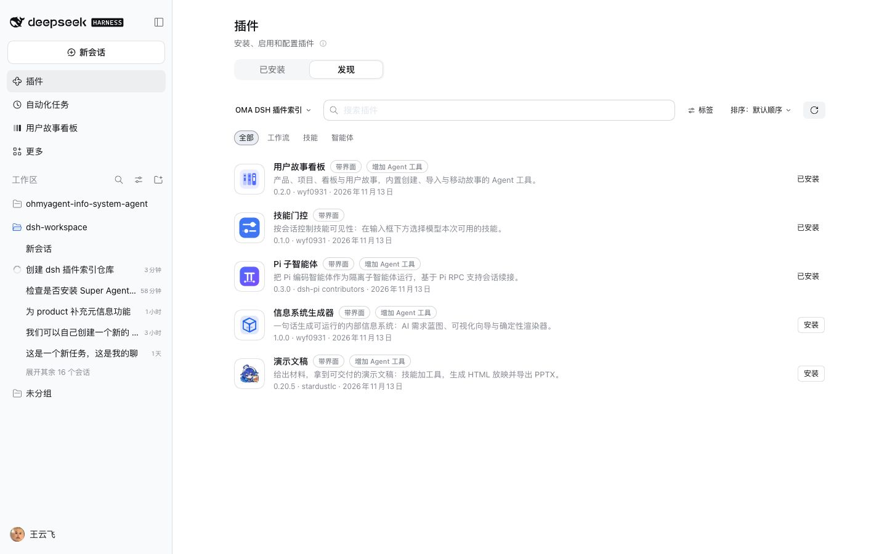

# OMA DSH Plugin Index

English | [中文](README.zh.md)

A plugin index for **DeepSeek Harness**: one JSON file that lists OMA's custom bundles, so anyone can browse and install them from **Plugins → Discover** inside DSH.

The index is self-contained. Every plugin's source is vendored under [`plugins/`](plugins/), and every version is pinned to a commit of this repository, so installing from the index needs no npm publishing and gets exactly the code this repository published.



*Discover lists the indexed bundles; this profile already links some of them locally, so those cards read 已安装 (installed).*

## Plugins

| Plugin | Version | What it does |
|---|---|---|
| [`dsh-story-board`](plugins/dsh-story-board/) | 0.2.0 | Products, projects, boards, and user stories, with agent tools that create, import, and move them. |
| [`skill-gate`](plugins/skill-gate/) | 0.1.0 | Per-session skill visibility: choose which skills the model can see from a control under the composer. |
| [`dsh-subagent-pi`](plugins/dsh-subagent-pi/) | 0.3.0 | Run the [Pi](https://github.com/earendil-works/pi-coding-agent) coding agent as an isolated subagent, with resumable sessions over Pi RPC. |
| [`dsh-info-system-builder`](plugins/dsh-info-system-builder/) | 1.0.0 | Turn one sentence into a running internal information system: AI blueprinting, a visual wizard, and a deterministic renderer. |
| [`dsh-ppt`](plugins/dsh-ppt/) | 0.20.5 | Turn source material into a deliverable presentation: a skill plus tools that build HTML decks and export PPTX. |

## Add the index

1. Update DSH to a version that supports plugin indexes (this index is tested with `0.2.2-rc.1`; the plugins require DSH `^0.2.1-rc.3`).
2. Open **Plugins** in the Web sidebar, then switch on **Custom plugin indexes** under **Experimental plugins** if it is off.
3. Open the **Discover** tab, click **Add index source**, and paste:

```
https://raw.githubusercontent.com/wyf0931/oma-dsh-plugin-index/main/index.json
```

A jsDelivr mirror is also available if the raw host is slow:

```
https://cdn.jsdelivr.net/gh/wyf0931/oma-dsh-plugin-index@main/index.json
```

Discover now lists the plugins above. Pick an entry to read its full description, choose a version, and install it.

## Install from the index

Click **Install** on a card and confirm. DSH installs the exact git spec the index provides, for example:

```
git+https://github.com/wyf0931/oma-dsh-plugin-index.git#<commit>&path:/plugins/dsh-story-board
```

- Installs are pinned to a commit, so a later change on `main` cannot alter what you installed.
- No npm package is required; pnpm clones this repository and installs the package directory.
- The first install asks for build-script approval only if the package declares one. These packages ship built files and declare no install scripts.
- To upgrade, remove the installed bundle and install the newer version (DSH currently reports updates but does not upgrade in place).
- If you already run a plugin from a local checkout, Discover shows it as installed for that package name. Remove the local link before installing the index version if you want the pinned copy.

## Repository layout

```
index.json            the format-1 index (this is the URL users add)
market.config.json    display metadata (titles, descriptions, categories, labels)
plugins/<name>/       vendored plugin packages, one directory per bundle
scripts/build-index.mjs   regenerate index.json from plugins/ + market.config.json
scripts/check-index.mjs   validate index.json with DSH's parser and verify pins
```

## Adding a plugin

1. Copy the package into `plugins/<name>/` (keep the built entry points; drop `node_modules`, `.git`, and lockfiles).
2. Add an entry to `market.config.json` with its directory, order, category, labels, icon, and localized title/description.
3. Commit the plugin files. This commit is the version users will install.
4. Generate the index from it:

```bash
npm install          # once, for the index validator
npm run build -- --commit "$(git rev-parse HEAD)"
```

5. Commit `index.json` and push.

The two-commit flow is intentional: the index cannot pin the commit that contains the index itself. The generated `index.json` therefore points at the commit that contains the plugin code, and the following commit only carries the index.

When you update a plugin, bump its `package.json` version and repeat the steps above. The generator keeps every earlier version row from the previous index, so the new version is added alongside the old ones and old versions stay installable.

## Validation

```bash
npm run check
```

This runs DSH's own `parseMarketIndex` (from `@deepseek-ai/dsh-plugin-market-index`) and then verifies what the parser cannot: that every pinned commit contains the package, that the working tree still matches the pin, that icons exist, and that `marketInstallTarget` produces the expected git spec. CI runs the same check on every push and pull request.

## Notes

- Index content is third-party input to DSH. Read a plugin's source before installing it; the index only describes what the pinned commit contains.
- `dsh-info-system-builder` is republished here under that name. Its upstream package name is the local-only `@local/info-system-builder`; the vendored copy renames it so the public index never installs a `@local` package.
- The index is intentionally unsigned. The commit pin gives reproducibility, not authorship; check the repository history if provenance matters.
- All plugins here are MIT licensed.

## License

MIT. See [LICENSE](LICENSE).
