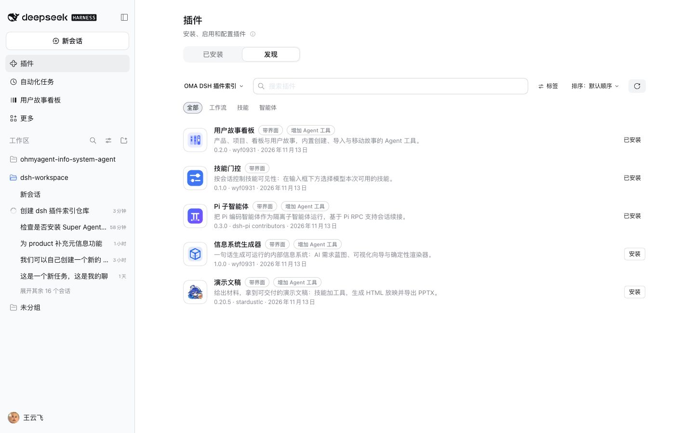

# OMA DSH 插件索引

[English](README.md) | 中文

这是一个 **DeepSeek Harness** 的插件索引：一份 JSON 文件，列出 OMA 的自定义插件包。把它加入 DSH 后，就能在 **插件 → 发现（Discover）** 里浏览、搜索并安装。

索引是自包含的：每个插件的源码都放在本仓库的 [`plugins/`](plugins/) 下，每个版本都固定到本仓库的一个提交。因此安装不依赖 npm 发布，用户装到的就是本仓库发布的那份代码。



*发现页会列出索引中的插件包；截图中的配置文件已经用本地链接安装了其中几个，所以对应卡片显示「已安装」。*

## 收录的插件

| 插件 | 版本 | 作用 |
|---|---|---|
| [`dsh-story-board`](plugins/dsh-story-board/) | 0.2.0 | 产品、项目、看板与用户故事，内置创建、导入与移动故事的 Agent 工具。 |
| [`skill-gate`](plugins/skill-gate/) | 0.1.0 | 按会话控制技能可见性：在输入框下方选择模型本次可用的技能。 |
| [`dsh-subagent-pi`](plugins/dsh-subagent-pi/) | 0.3.0 | 把 [Pi](https://github.com/earendil-works/pi-coding-agent) 编码智能体作为隔离子智能体运行，基于 Pi RPC 支持会话续接。 |
| [`dsh-info-system-builder`](plugins/dsh-info-system-builder/) | 1.0.0 | 一句话生成可运行的内部信息系统：AI 需求蓝图、可视化向导与确定性渲染器。 |
| [`dsh-ppt`](plugins/dsh-ppt/) | 0.20.5 | 给出材料，拿到可交付的演示文稿：技能加工具，生成 HTML 放映并导出 PPTX。 |

## 添加索引

1. 把 DSH 更新到支持插件索引的版本（本索引在 `0.2.2-rc.1` 上验证；插件要求 DSH `^0.2.1-rc.3`）。
2. 打开侧边栏的 **插件** 页面。如果 **实验性插件** 里的 **自定义插件索引** 还没打开，先打开它。
3. 进入 **发现** 标签，点 **添加索引源**，粘贴：

```
https://raw.githubusercontent.com/wyf0931/oma-dsh-plugin-index/main/index.json
```

如果 raw 域名访问慢，也可以用 jsDelivr 镜像：

```
https://cdn.jsdelivr.net/gh/wyf0931/oma-dsh-plugin-index@main/index.json
```

jsDelivr 会缓存 `main`，发布后可能滞后几分钟。发布后可以执行 `curl https://purge.jsdelivr.net/gh/wyf0931/oma-dsh-plugin-index@main/index.json` 刷新缓存；需要最新索引时直接用 raw 地址。

添加后，发现页就会列出上面的插件。点开条目可以看完整介绍、选择版本并安装。

## 从索引安装

在卡片上点 **安装** 并确认。DSH 会用索引给出的精确 git 规格安装，例如：

```
git+https://github.com/wyf0931/oma-dsh-plugin-index.git#<commit>&path:/plugins/dsh-story-board
```

- 安装固定到提交，之后 `main` 上的改动不会影响已安装的版本。
- 不需要 npm 包；pnpm 会克隆本仓库并安装对应的子目录。
- 只有当插件声明了安装脚本时才会请求构建批准。这些包都直接携带构建产物，没有安装脚本。
- 升级方式是先移除旧版本，再安装新版本（DSH 目前只提示可更新，不支持原地升级）。
- 如果你已经用本地目录（`link:`）安装了同名插件，发现页会显示已安装。想换成索引里的固定版本，需要先移除本地链接。

## 仓库结构

```
index.json            格式 1 的索引（用户添加的就是这个地址）
market.config.json    展示元数据（标题、简介、分类、标签）
plugins/<name>/       每个插件包一个目录
scripts/build-index.mjs   用 plugins/ + market.config.json 生成 index.json
scripts/check-index.mjs   用 DSH 官方解析器校验索引并核对提交
```

## 新增插件

1. 把插件包复制到 `plugins/<name>/`（保留构建产物；去掉 `node_modules`、`.git` 和锁文件）。
2. 在 `market.config.json` 里加一条：目录、排序、分类、标签、图标、中英文标题和简介。
3. 提交插件文件。这个提交就是用户将来安装的版本。
4. 用这个提交生成索引：

```bash
npm install          # 首次运行，安装索引校验器
npm run build -- --commit "$(git rev-parse HEAD)"
```

5. 提交 `index.json` 并推送；如果使用 jsDelivr 镜像，再执行一次缓存刷新。

两次提交是刻意设计的：索引无法固定到包含索引自身的提交。因此生成的 `index.json` 指向包含插件代码的那个提交，后一次提交只携带索引。

更新插件时，先提升它的 `package.json` 版本并重复上面的步骤。生成器会保留上一份索引里的所有旧版本行，因此新版本会追加在旧版本旁边，旧版本仍然可以安装。

## 校验

```bash
npm run check
```

它会调用 DSH 官方的 `parseMarketIndex`（来自 `@deepseek-ai/dsh-plugin-market-index`），再检查解析器无法覆盖的部分：固定的提交里确实包含该包、工作区与固定提交一致、图标存在，以及 `marketInstallTarget` 生成的 git 规格符合预期。CI 在每次 push 和 PR 时运行同样的检查。

## 说明

- 索引内容是 DSH 的第三方输入。安装前请阅读插件源码；索引只描述固定提交里有什么。
- `dsh-info-system-builder` 在本索引里以该名字重新发布。它的上游包名是仅限本地的 `@local/info-system-builder`；仓库内的副本改了名，避免公共索引安装一个 `@local` 包。
- 索引不签名。提交固定保证可复现，不证明作者身份；在意来源时请查看仓库提交历史。
- 本仓库的插件均为 MIT 许可。

## 许可

MIT，见 [LICENSE](LICENSE)。
