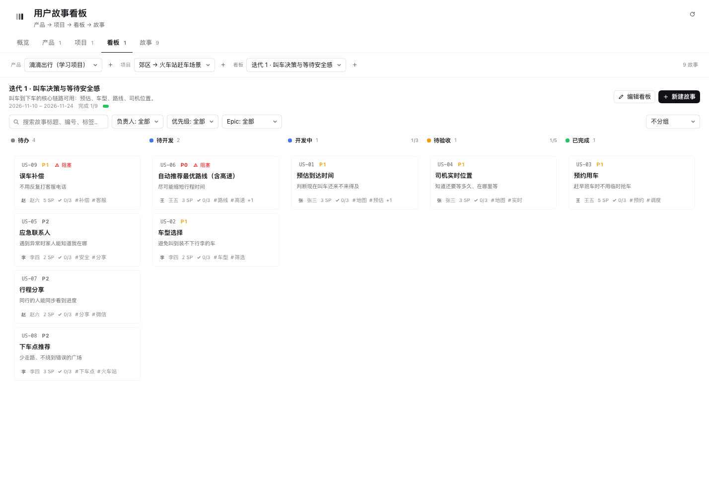
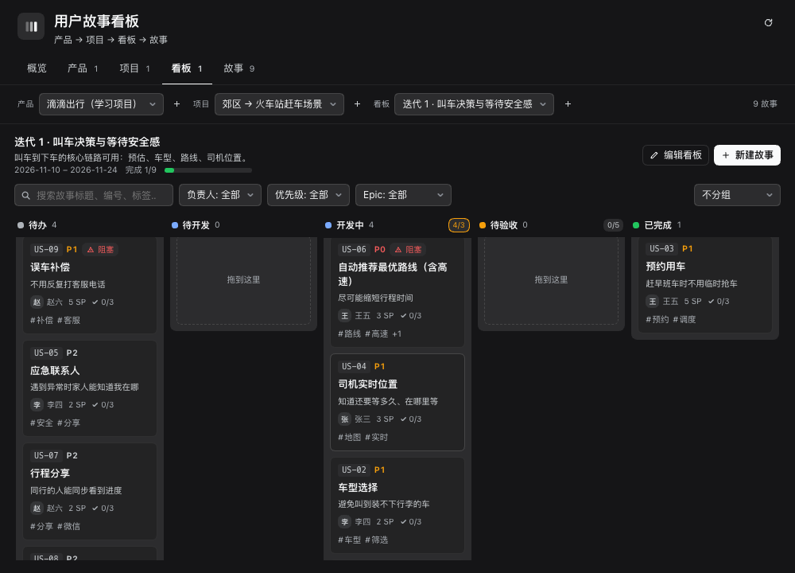
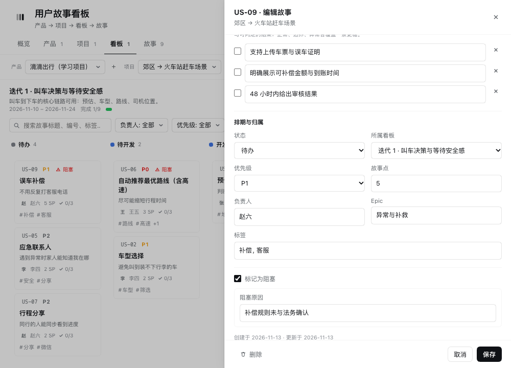
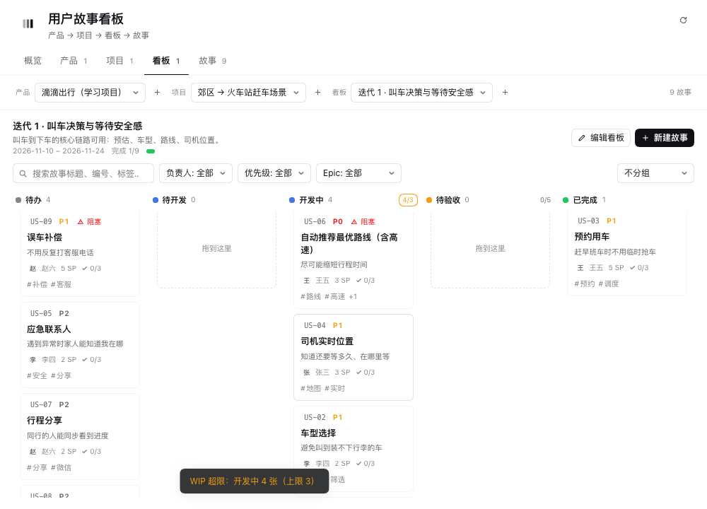
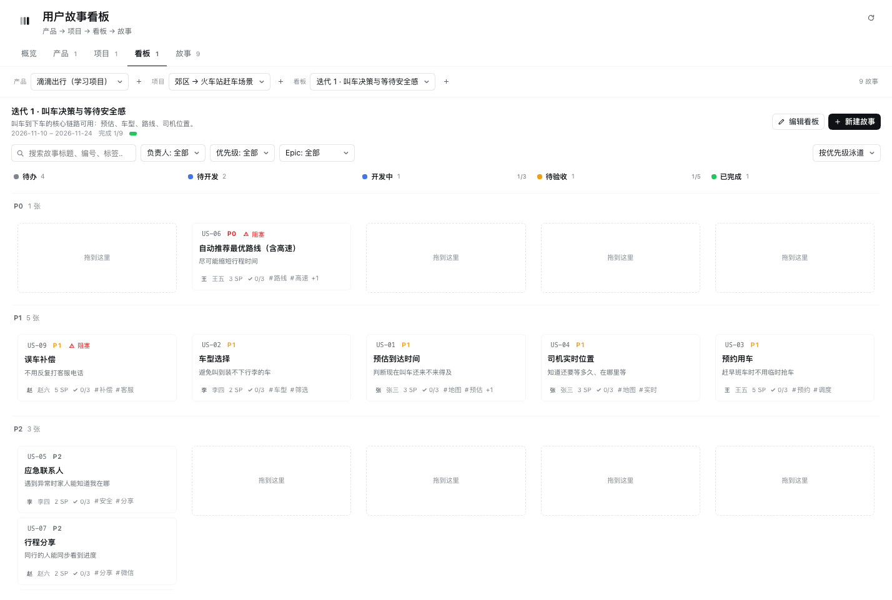
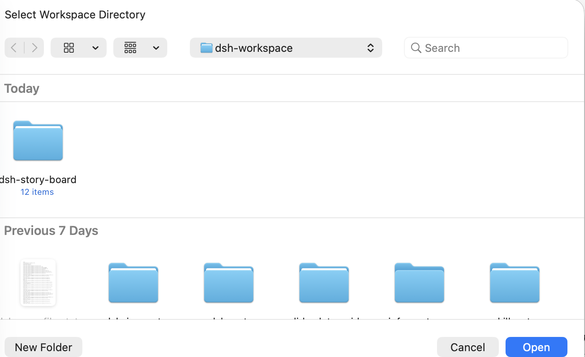

# dsh-story-board

[](https://github.com/deepseek-ai/deepseek-harness)
[](LICENSE)
[](https://nodejs.org/)

[中文](README.md) | [English](#english)

一个给 [DeepSeek Harness](https://github.com/deepseek-ai/deepseek-harness) 用的**用户故事看板**插件：产品 → 项目 → 看板 → 用户故事四层结构，五列状态泳道、WIP 提醒、卡片拖拽、验收标准清单，以及让 AI 直接创建/导入/推进故事的 Host 工具。

它把「故事文档」变成「会流动的卡片」：侧边栏点开就是看板，模型在对话里也能用同一套数据建项目、导入故事、拖动状态。



---

## 它解决什么

敏捷对话里常见的三个问题：

1. **故事只活在文档里**：写完一份 `user-stories-xxx.md`，没人知道现在做到哪。
2. **所有故事堆一个板**：Done 列越来越长，当前迭代的重点反而看不清。
3. **看板和对话是两套数据**：AI 说"已更新"，面板里却没变。

这个插件用一条数据链解决：**面板和 Agent 工具读写同一个 JSON store**。你在对话里说"把 US-06 移到开发中"，面板刷新就能看到；你在面板里拖卡，模型下一次 `story_board_query` 也能读到。

## 层级与列

```
产品 Product（滴滴出行）
 └── 项目 Project（郊区 → 火车站赶车场景）   ← 一个项目 = 一个隔离的看板空间
      └── 看板 Board（迭代 1 · 叫车决策）
           └── 故事 Story（US-01 预估到达时间）
```

| 状态 | 列 | 含义 | 默认 WIP |
|---|---|---|---|
| `backlog` | 待办 | 候选池，不承诺全部做 | 不限 |
| `todo` | 待开发 | 已排进本次迭代 | 不限 |
| `in_progress` | 开发中 | coding / 联调 | 3 |
| `verify` | 待验收 | 等 PO / 测试验收 | 5 |
| `done` | 已完成 | 满足 DoD | 不限 |

- WIP 是**提醒**不是硬拦截：移动成功，返回 `wip_exceeded` 警告，列头变色。
- 故事不设 `boardId` 时属于**项目待办池**（`backlog`），不会混进迭代板。

## 界面

| 看板（浅色） | 看板（深色） |
|---|---|
|  |  |

| 故事详情抽屉 | WIP 超限提醒 |
|---|---|
|  |  |

按优先级泳道（卡片统一最小高度）：



故事表格视图见 [docs/stories.png](docs/stories.png)。

## 功能

### 面板（侧边栏「用户故事看板」）

- **概览**：产品/项目/看板/故事/故事点/阻塞 KPI，状态分布条，WIP 健康度，阻塞清单，最近动态。
- **产品**：产品卡片（Key、描述、项目/看板/故事数、完成数、代码仓库与本地项目路径），新建/编辑/删除（级联提示）；仓库与本地路径支持手输或系统目录选择，保存后把看板和代码 checkout 关联起来。
- **项目**：按产品过滤的项目列表，目标、日期、看板数、故事数、完成度进度条，一键打开看板。
- **看板**：五列状态泳道；可按 **Epic / 优先级 / 负责人** 切泳道；搜索 + 负责人/优先级/Epic 筛选；卡片拖拽换列、拖到卡片上插到它前面；列头实时 WIP 计数与超限提示。
- **故事**：表格视图，搜索与多条件筛选，可直接改状态，点行打开详情。
- **故事抽屉**：标题、Connextra 三段（作为/我想要/以便于）、AC 清单（可勾选完成、增删）、状态、优先级、故事点、负责人、Epic、标签、所属看板、阻塞标记与原因、删除。
- **空状态**：一键「载入示例（滴滴赶车 · 9 个故事）」，立刻看到完整看板。

卡片上固定六类信息：稳定编号、动宾标题、价值一句话、优先级、负责人/故事点/AC 完成度、标签与阻塞标记。这是"3 秒内决定要不要拉这张卡"的最小集合。卡片有统一的最小高度（108px），信息少时不会塌成一条，内容多时自然增高；实测 9 张示例卡均为 108px 且无内容溢出。

### 产品代码关联



仓库支持 `owner/repo`、`git@host:owner/repo`、ssh/https 等写法，保存时归一化为 https 地址；本地路径可直接输入，也可点「选择…」调用系统原生目录选择器。两者都随产品记录持久化，Agent 工具用 `repoUrl` / `localPath` 读写。

### Agent 工具

| 工具 | 用途 |
|---|---|
| `story_board_query` | 读：`overview` / `products` / `projects` / `boards` / `stories` / `story` / `board`，带过滤 |
| `story_board_apply` | 写：创建/更新/删除产品、项目、看板、故事；`move_story`；`seed_demo`；`reset_store` |
| `story_board_import` | 一份 Markdown 或结构化数组一次落板；按名字自动建产品/项目/看板；同 key/标题幂等更新 |

示例（模型侧）：

```json
{"action":"create_product","name":"dsh-story-board","key":"STORY",
 "repoUrl":"wyf0931/dsh-story-board",
 "localPath":"/Users/scott/Documents/dsh-workspace/dsh-story-board"}
```

```json
{"action":"create_story","projectId":"prj_…","boardId":"brd_…","title":"预估到达时间",
 "asA":"赶高铁的乘客","iWant":"在叫车前看到预估到达时间","soThat":"判断还来不来得及",
 "acceptanceCriteria":["Given … When … Then …"],"priority":"P1","estimate":3,"assignee":"张三"}
```

```json
{"markdownPath":"user-stories-郊区赶车.md","productName":"滴滴出行",
 "projectName":"郊区赶车场景","boardName":"迭代 1 · 叫车决策"}
```

### Skill

- 本仓库内置看板 skill：[`skills/user-story-board/`](skills/user-story-board/SKILL.md) — 看板模型、五列/WIP/DoD、三类工具的参数与标准流程、导入格式、与 crafter 的衔接。
- 配套的 `user-story-crafter` skill（不在此仓库）在产出文档后，若会话有 `story_board_import`，会默认落板并给出第一个迭代的拉取建议（幂等，可反复导入）。
- 安装 skill：把 `skills/user-story-board/` 复制到项目的 `.skills/`（或用户级技能目录），新会话即可被发现。看板面板与工具不依赖该 skill 才能工作。

## 安装

### 要求

- Node >= 22
- DSH 0.2.x（本插件在 `0.2.1-rc.3` / `0.2.2-rc.1` 的 Web 壳中验证）
- 无第三方运行时依赖，无需构建

```bash
git clone git@github.com:wyf0931/dsh-story-board.git
```

使用 Plugin Manager 安装 bundle，`target` 指向仓库的绝对路径：

```text
plugin_manager → action: install_bundle
                 target: /absolute/path/to/dsh-story-board
```

或通过 CLI 装进指定 profile：

```bash
dsh plugin --profile <profile> add /absolute/path/to/dsh-story-board
```

- **浏览器半**：刷新页面后，侧边栏出现「用户故事看板」。
- **Host 半**：工具与路由在安装结果 `application: applied` 后即可用；改 `index.js` / `store.js` 需要重装 bundle 或重启应用以加载新模块（`client.js` 刷新页面即可）。
- 安装角色是链接（link）安装：改仓库文件无需再次发布；profile 通过链接引用检出目录。

## 数据与备份

```text
$DSH_HOME/story-board/store.json        # 默认 ~/.dsh/story-board/store.json
```

- 单文件、原子写入（临时文件 + rename），同进程写操作串行化。
- 跨进程读取按文件 mtime 自动刷新；跨进程**同时写**是 last-writer-wins，没有文件锁。
- `DSH_STORY_BOARD_STORE=/path/to/store.json` 可覆盖位置（测试或多 store 场景）。
- 建议备份：复制该文件即可；重置：停止写入后删除该文件，或在对话中让 Agent 调用 `reset_store`。
- 不要把 store 放进 git 仓库；故事数据属于用户，不属于插件代码。

## 仓库结构

```text
dsh-story-board/
├── index.js                 # Host：Cordis 插件入口，3 个工具 + 2 条 /api 路由
├── store.js                 # 领域层：文档模型、命令、WIP、Markdown 导入
├── client.js                # 浏览器半：main 面板 + sidebar 入口，纯 React
├── cordis.patch.yml         # 一行 Loader 条目
├── locale/{zh,en}.json      # 插件元数据（标题/描述）
├── icon.svg                 # 插件图标
├── skills/user-story-board/ # 看板 skill（可选安装）
├── docs/                    # 真实运行截图
├── test/                    # node:test 领域测试 + jsdom 面板 smoke
└── .github/workflows/test.yml
```

## 与 DSH 插件规范的对齐

- 面板注册在 `main` 槽位（key `dsh-story-board`），入口是 `sidebar.panellist`，没有 iframe、没有替换 app root。
- 全部样式走 `--dsw-alias-*` / `--dsw-elevation-*` / `--dsw-mask-blur` 主题 token；无硬编码主题色（icon 作为 artwork 例外）。
- 文案走 `ctx.locale.register(NS, DICT)` + `ctx.locale.bind(NS)`，中英双语；不 `require` 任何 Harness Client 包。
- 数据路由走 `connection.fetch.register` 的认证 `/api` 通道；工具与 UI 调用同一份 `StoryBoardStore`（user-action 规范的"一个操作两个调用方"）。
- 所有注册都在 `ctx.effect` 中并返回清理；Client 样式卸载时移除。
- 图标、`meta.title` / `meta.description` 中英文资源齐全，`files` 覆盖所有运行文件。

## 开发与测试

```bash
cd dsh-story-board
npm test          # 18 个 domain 测试 + 1 个 jsdom 面板 smoke 测试
npm run check     # 语法检查 + 全部测试
```

浏览器 smoke 测试会从同工作区的 `dsh-superagent` 借用 React 18 / jsdom；检出目录不存在时该测试自动跳过，插件本身不引入这些依赖。

## 验证记录（2026-11-13）

- ✅ 18 个 store 测试：层级/编号、状态与 WIP（含 null 关闭上限）、拖动排序、Markdown 解析、幂等导入、拒绝孤儿产品、清空/重置、级联删除、持久化、同进程并发写、跨实例 mtime 刷新、写失败回滚。
- ✅ jsdom 面板 smoke：真实 React 18 渲染概览、切「看板」、五列与卡片、打开故事抽屉与 AC；无 slot crash。
- ✅ 三个工具已真实调用：`story_board_query`（overview/products/board）、`story_board_import`（自动建产品/项目/看板 + 2 条故事）、`story_board_apply`（`move_story`、`delete_product`、`reset_store`）。
- ✅ 在真实 DSH Web shell（同一套 `dsh-web-app` + 本 bundle，临时 profile）中完成截图验证：五列状态泳道、拖拽换列（待开发 → 开发中，计数与 WIP 同步）、WIP 超限 toast 与列头变色、故事抽屉、产品/项目/故事 Tab、明暗两套主题、产品创建/级联删除确认、卡片 108px 最小高度与无溢出。截图见 `docs/`。

## 已知限制 / 路线图

- 单机单文件 store；跨进程同时写没有锁。需要多端/多人同时写入时应换成带锁的存储后端（SQLite/服务端）。
- 看板列固定为五列；列自定义、按旅程阶段切板、发布看板未实现。
- 无燃尽图/累积流图/前置时间统计；概览只有分布、WIP、阻塞与动态。
- 拖拽只改状态与同列顺序；不支持跨泳道拖拽改 Epic/负责人（用抽屉改）。
- 无移动端专门布局（窄窗口可用，列横向滚动）。
- 后续：`story_board_export`（导出 Markdown/CSV）、迭代指标、看板模板、批量选择与批量移动。

## 参考

- PMI《敏捷实践指南》— Epic/Story/Task 分层、看板与 Scrum 混合、WIP 与流动效率
- [Quire: How to use Kanban boards](https://quire.io/blog/p/kanban-boards-for-project-management.html) — WIP 计数的可见性
- [Wekan: cards as user stories](https://github.com/wekan/wekan/blob/60377a4dc262149b1c69aed534baab03798198f8/docs/Features/Cards/Scrum.md) — AC checklist 与卡片进度
- [Designing effective Kanban boards](https://github.com/gethamster/skills/blob/7c00f4d4f6f72d2b9450fda6d015382b660cb7ad/skills/designing-kanban-boards/references/faq.md) — 列数与泳道触发条件
- DSH `cordis-plugin-development` 指南：bundle manifest、main/sidebar 槽位、主题 token、locale、effect 清理

---

## English

A user-story board bundle for [DeepSeek Harness](https://github.com/deepseek-ai/deepseek-harness). Four levels — product → project → board → story — with five status lanes, advisory WIP limits, drag-and-drop cards, acceptance-criteria checklists, and three agent tools (`story_board_query`, `story_board_apply`, `story_board_import`) that write the same store the panel reads.

- **Panel**: a sidebar entry opens a five-tab page (overview, products, projects, board, stories). The board supports swimlanes by epic/priority/assignee, filters, drag between columns, and a story drawer with Connextra text + AC checklist.
- **Tools**: query, apply (CRUD + `move_story` + `seed_demo` + `reset_store`), and import from Markdown or a structured array. WIP limits are advisory and surface as warnings.
- **Skill**: [`skills/user-story-board/`](skills/user-story-board/SKILL.md) documents the model, tool SOP, and import format. Pair it with your `user-story-crafter` skill for document → board handoff.
- **Data**: `~/.dsh/story-board/store.json`, atomic writes, serialized commands, mtime refresh across processes.
- **No runtime dependencies**; host tools are wired in `index.js`, the browser half in `client.js`.

Install with `plugin_manager install_bundle` targeting the cloned directory (see [安装](#安装)). Test with `npm test` (18 domain tests + a jsdom panel smoke test). Screenshots in [`docs/`](docs/) come from the same client bundle running in a real DSH web shell.

## License

[MIT](LICENSE)
