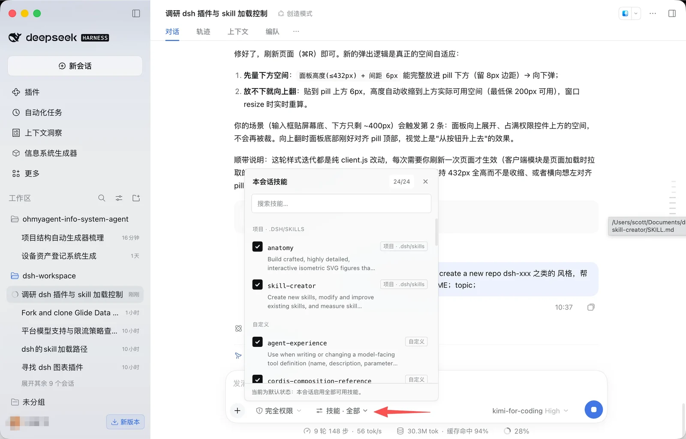

# dsh-skill-gate

English | [中文](README.zh.md)

[](https://github.com/deepseek-ai/deepseek-harness)

## Summary

`dsh-skill-gate` adds **per-session skill visibility control** to [DeepSeek Harness](https://github.com/deepseek-ai/deepseek-harness). A compact control in the composer tool row — right next to the permission control — opens a checklist of every skill the current session's composition can see. Uncheck a skill and it leaves the session completely: it disappears from the model's `<available_skills>` catalog, the `skill` tool refuses to load it, and `/name` gestures stop injecting it.

This is the visual, reversible equivalent of a CLI's `--skill x,y,z` flag. It exists for one job: when many skills live in a shared directory such as `~/.agents/skills/` and several of them conflict across business contexts, you decide — explicitly, per session — which ones the model may use, so the model cannot hallucinate its way into the wrong playbook.

The default stays exactly DSH's native behavior: **every skill enabled, no restriction**, until you uncheck something.

**Selection is locked once the conversation has started.** The control is live in a new session, before the first message. After the first turn the pill renders disabled and reads `Skills · locked`, so a session's skill set cannot drift mid-conversation.



| Piece | Role |
|---|---|
| `index.js` (Host) | Wraps the `skills` service's `list`/`snapshot`/`get` with per-session filtering; persists gate state to `~/.dsh/skill-gate/state.json`; serves two authenticated `/api` routes on the connection's shared channel |
| `client.js` (Browser) | The `conversation.input.left` slot control: a borderless tool-row pill plus a grouped, searchable checklist popover |
| `cordis.patch.yml` | One loader row; the browser half is discovered through the package's `dsh.client` declaration |

## Features

- **Native look and feel.** The control adopts the composer bar's borderless tool-row design (chevron, hover wash, 13px medium label) and opens a menu-surface popover that flips upward when the viewport is short.
- **Grouped, searchable checklist.** Skills are grouped by source root — project `.dsh/skills`, project `.agents/skills`, custom directories, user `.dsh/skills`, user `.agents/skills`, bundled, and runtime — so business skills stand apart from built-ins. Search filters across name, description, and path.
- **Three-stage master checkbox.** The row above the first group is a one-click switch over the whole catalog: all → built-in only → none → all. *Built-in only* keeps bundled, custom, and runtime skills and clears every user and project skill; the box renders checked, mixed (a dash), or empty to match the selection, and manual per-skill picks can continue from any stage. Hover the row for the cycle hint.
- **One mental model: checked = visible.** The stored state is an allowlist of exactly what the model sees. Checking everything collapses back to the unrestricted default (`null`), so "back to normal" is always one click ("Enable all") and never drifts.
- **Enforced at the registry boundary.** Filtering wraps the live `skills` registry, so the durable catalog published at every agent step, the `skill` tool's lookup, the `/name` gesture injection, and the UI's session skill list all agree — no partial views, no stale entries.
- **Instant, durable, hot-reloadable.** In a new session, changes apply on the model's next step (DSH republishes the catalog automatically) and persist per session id. After the first turn the control locks, keeping a running conversation's skill set fixed. The state file is written atomically and watched, so hand edits and external tooling stay in sync. A *default* scope covers sessions that have no selection yet.
- **Zero dependencies.** The bundle imports nothing from `@deepseek-ai/*`; every capability is reached through injected Cordis services, following the same `connection.fetch` channel pattern as `dsh-context`.

## Requirements

- Node >= 22.19.0
- A DSH runtime that satisfies `engines.dsh` (`^0.2.2-rc.5`), with the skills capability mounted (any profile built on `@deepseek-ai/dsh-base`)

## Install

From a clone of this repository, install the bundle into a profile with the Plugin Manager (`install_bundle`, target = the absolute package directory) or the `dsh` CLI. Then refresh the Web UI — the browser half is fetched at page load.

```sh
git clone https://github.com/wyf0931/dsh-skill-gate.git
```

```text
plugin_manager  →  action: install_bundle
                  target: /absolute/path/to/dsh-skill-gate
```

The profile links the checkout, so editing `client.js` takes effect after a page refresh, and editing `index.js` after an application restart.

## Usage

1. **Open a new session** (before sending the first message). The control reads `Skills · all` (everything enabled), or `Skills N/M` with the glyph and count tinted blue when a restriction exists.
2. Click it. Use the **All skills** checkbox above the groups for the quick cycle — all → built-in only → none — then refine individual skills. Each toggle persists immediately.
3. The next model step carries the reduced `<available_skills>` catalog; disabled skills are un-loadable by the model and by `/name`.
4. Click **Enable all** (or re-check everything) to return to the unrestricted default. In a session-less composer the control edits the *default* scope inherited by new sessions.
5. **Once the conversation has started the pill is disabled** and reads `Skills · locked` — pick skills before the first message. Existing per-session selections can still be reset by editing the state file below.

Newly installed skills are detected dynamically through the filesystem provider's watchers and appear in the picker on the next open; while a restriction is active they start unchecked, keeping the allowlist honest.

## State

```
~/.dsh/skill-gate/state.json
```

```json
{
  "default": null,
  "sessions": {
    "session-…": ["archify", "office"]
  }
}
```

`default: null` means "no restriction". A per-session entry overrides the default; `null` inside `sessions` is normalized away. The file is the source of truth — edits are picked up live via an fs watch — and writes are atomic (temp file + rename). Entries are pruned past 500 sessions.

## Limitations

- **Subagents do not inherit the gate.** Forked/spawned children run under their own session ids and fall back to the default scope. This is deliberate: delegated tasks are usually orthogonal, but per-child gating can be added if a use case demands it.
- **Host code updates need an application restart.** A linked install serves `index.js` from the checkout; the running host caches the module per process.
- The Host half wraps the `skills` service's public `list`/`snapshot`/`get` contract (the same methods DSH's own `tool-skill` calls). If a future DSH version renames them, the plugin logs a warning and degrades to "no restriction" rather than breaking sessions.

## License

[MIT](LICENSE)
