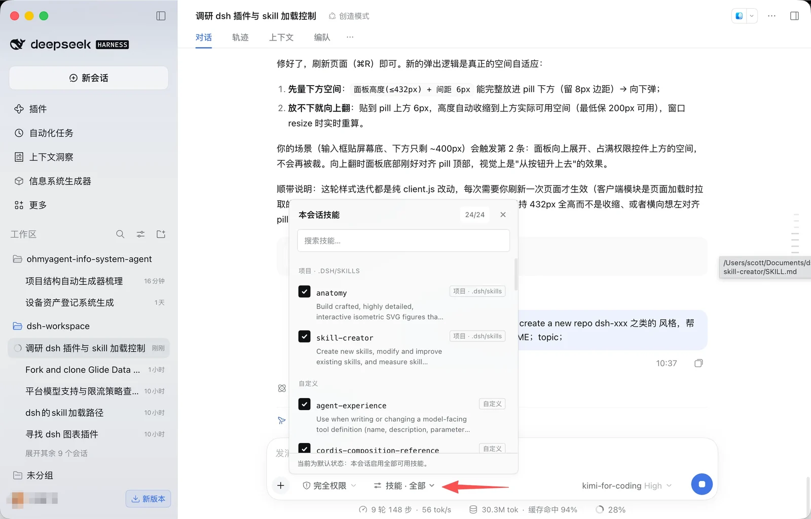

# dsh-skill-gate

[English](README.md) | 中文

[](https://github.com/deepseek-ai/deepseek-harness)

## 简介

`dsh-skill-gate` 为 [DeepSeek Harness](https://github.com/deepseek-ai/deepseek-harness) 增加**会话级技能可见性控制**。输入框工具行里、权限控件旁边多了一个紧凑开关，点击弹出当前会话可见的全部技能清单。取消勾选后，该技能会从会话中彻底消失：模型的 `<available_skills>` 目录不再列出它、`skill` 工具拒绝加载、`/名称` 手势也不再注入。

它相当于 CLI 里 `--skill x,y,z` 这种显式启用参数的图形化、可逆版本。它只为一件事存在：当大量技能放在 `~/.agents/skills/` 这类统一目录、且不同业务场景之间相互冲突时，你可以按会话明确指定模型能用哪些——让模型没有幻觉误用错误 playbook 的空间。

默认值与 DSH 原生行为完全一致：**全部启用、不做限制**，直到你主动取消勾选。

**会话开始后选择即锁定。** 新会话里、发送第一条消息之前，控件可随时调整；发出第一条消息后 pill 变为禁用并显示 `技能 · 已锁定`，避免运行中的对话中途改变技能集合。



| 组成 | 职责 |
|---|---|
| `index.js`（Host） | 包装 `skills` 服务的 `list`/`snapshot`/`get`，按会话过滤；把门控状态持久化到 `~/.dsh/skill-gate/state.json`；在 connection 共享通道上提供两个鉴权 `/api` 路由 |
| `client.js`（浏览器） | `conversation.input.left` 槽位控件：无边框工具行 pill + 按来源分组、可搜索的勾选弹层 |
| `cordis.patch.yml` | 一行 Loader 条目；浏览器半通过包的 `dsh.client` 声明被发现 |

## 特性

- **原生观感**：控件采用 composer 工具行的无边框设计（下拉箭头、hover 底色、13px 中灰文字）；弹层为菜单浮层，视口空间不足时自动向上展开。
- **按来源分组 + 搜索**：技能按来源根目录分组——项目 `.dsh/skills`、项目 `.agents/skills`、自定义目录、用户 `.dsh/skills`、用户 `.agents/skills`、内置、运行时——业务技能与内置技能一目了然；搜索支持名称、描述、路径。
- **一个心智模型：勾选 = 可见**：存储状态就是模型可见技能的 whitelist。全部勾选自动折叠回无限制默认（`null`），"恢复正常"永远只需点一下「全部启用」。
- **在注册表边界强制生效**：过滤包装在 `skills` 服务上，每个 agent step 发布的持久化目录、`skill` 工具查询、`/名称` 手势注入、UI 的会话技能列表，四处视图完全一致。
- **即时、持久、热重载**：新会话里，改动在模型下一步即生效（DSH 会自动重新发布目录），并按会话 id 持久化；**发出第一条消息后控件锁定**，保持运行中会话的技能集合固定。状态文件原子写入并被监听，手工编辑、外部工具改动实时同步。无选择的会话走 *default* 作用域。
- **零依赖**：不 import 任何 `@deepseek-ai/*` 包，全部能力通过注入的 Cordis 服务获取，数据通道沿用 `dsh-context` 同款 `connection.fetch` 模式。

## 要求

- Node >= 22.19.0
- 满足 `engines.dsh`（`^0.2.1-rc.3`）的 DSH 运行时，且已挂载 skills 能力（任何基于 `@deepseek-ai/dsh-base` 的 profile）

## 安装

克隆本仓库后，用 Plugin Manager（`install_bundle`，target 为包的绝对路径）或 `dsh` CLI 把 bundle 安装到 profile，然后刷新 Web UI（浏览器半在页面加载时拉取）。

```sh
git clone https://github.com/wyf0931/dsh-skill-gate.git
```

```text
plugin_manager  →  action: install_bundle
                  target: /absolute/path/to/dsh-skill-gate
```

Profile 以链接方式引用该检出目录：改 `client.js` 刷新页面即生效，改 `index.js` 需重启应用。

## 使用

1. **在新会话里、发送第一条消息之前**看输入框工具行：控件显示 `技能 · 全部`（全部启用）；存在限制时显示 `技能 N/M`，图标与计数染蓝。
2. 点击，取消不属于本会话业务场景的技能，每次切换立即持久化。
3. 模型的下一步即携带缩减后的 `<available_skills>` 目录；被禁技能模型与 `/名称` 均不可用。
4. 点「全部启用」（或重新全部勾选）恢复无限制默认。无会话的输入框里，控件编辑的是新会话继承的*默认*作用域。
5. **发出第一条消息后 pill 禁用**，显示 `技能 · 已锁定`；如需改动，请在新会话里预先选择，或直接编辑下面的状态文件。

新安装的技能经文件系统 provider 的监听动态发现，下次打开面板即出现；受限状态下它们默认未勾选，保证白名单的明确性。

## 状态文件

```
~/.dsh/skill-gate/state.json
```

```json
{
  "default": null,
  "sessions": {
    "session-…": ["archify", "office"]
  }
}
```

`default: null` 表示"不限制"；会话级条目覆盖默认值；`sessions` 内的 `null` 会被归一化删除。文件即事实来源——编辑经 fs watch 实时生效——写入为原子操作（临时文件 + rename）。超过 500 个会话条目自动裁剪。

## 已知限制

- **子代理不继承门控**：fork/spawn 的子会话使用各自的 session id，回退到默认作用域。这是刻意设计（委派任务通常正交）；如有需要可以再加按子会话门控。
- **Host 代码更新需重启应用**：链接安装直接从检出目录提供 `index.js`，运行中的宿主按进程缓存模块。
- Host 半包装的是 `skills` 服务的公开契约 `list`/`snapshot`/`get`（DSH 自带 `tool-skill` 调用的也是这三个方法）。若未来 DSH 版本改名，插件会打警告日志并降级为"不限制"，而不会破坏会话。

## License

[MIT](LICENSE)
